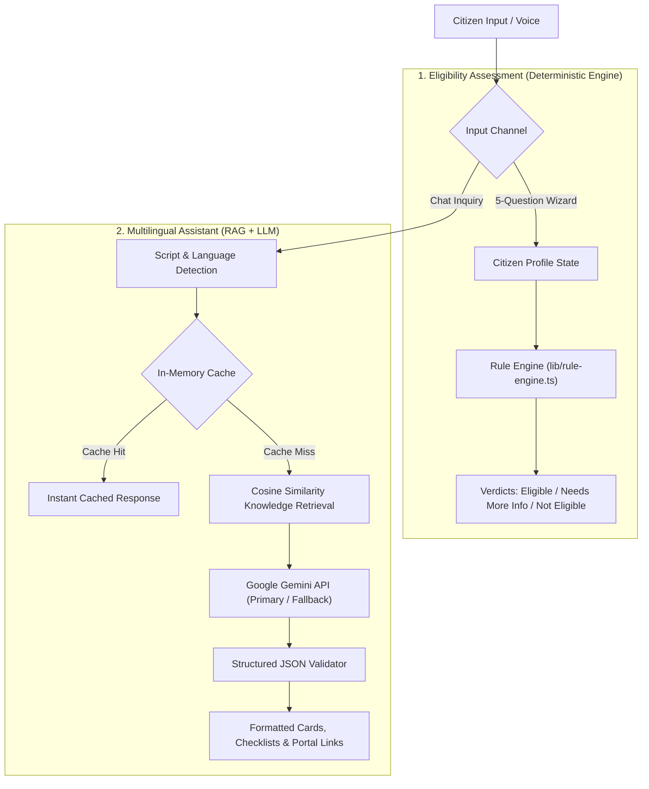

# SEVA.AI: National Scheme Assistant

> A mobile-first, multilingual civic assistant that helps Indian citizens discover government welfare schemes, check preliminary eligibility, and receive clear answers in their native language.

Live Demo: https://ai-scheme-assistant-kjm5.vercel.app/

---

## The Problem & Target Audience

Information about central government welfare schemes is scattered across multiple departments and typically published in complex bureaucratic English or Hindi. This creates significant access barriers for rural families, informal workers, and regional-language speakers who are often the most eligible beneficiaries. SEVA.AI is built for citizens, common service center (CSC) operators, and community volunteers seeking simple, grade-5 reading level scheme guidance in English, Hindi, Bengali, or Tamil.

---

## Key Features

- **4 Supported Languages:** English (`en-IN`), Hindi (`hi-IN`), Bengali (`bn-IN`), and Tamil (`ta-IN`) with script-native Noto Sans fonts and mobile viewport layout tested at 360px width.
- **5-Question Eligibility Wizard:** Rapid questionnaire covering residence, occupation, age, gender, and family income to compute preliminary eligibility.
- **Deterministic Rule Engine:** Completely separated rule-based logic (`lib/rule-engine.ts`) with mathematical threshold checks on age limits, income ceilings, landholding acreage, and occupation categories.
- **Grounded Multilingual Chat:** RAG retrieval across 15 curated central welfare schemes returning validated, structured responses (summary, financial benefits, document checklist, actionable next steps, and official application URLs).
- **Language & Script Detection:** Automatic Unicode character analysis for regional scripts and phonetic Hinglish input translation to Devanagari Hindi.
- **Audio & Voice Capabilities:** Voice input with a server-side transcription fallback; audio playback where pre-generated audio exists only for the PM-KISAN scheme, otherwise browser voices or a server text-to-speech fallback that is limited by free-tier quotas.
- **Category Browsing & Bookmarks:** Direct browsing by citizen category (Farmers, Students, Health, Women, Senior Citizens, Jobs & Work, Housing) without unsolicited badges, plus local bookmarking.
- **Mobile-First Experience:** 100dvh splash screen, fixed navigation with 48px touch targets, system-based dark mode, and reduced-motion compliant transitions.

---

## How It Works

SEVA.AI separates factual conversational assistance from eligibility calculation:

1. **Eligibility Engine (Deterministic):** User responses from the 5-question wizard are passed directly into the rule engine. The engine evaluates criteria against statutory constraints without using an LLM, generating transparent verdicts: *Eligible*, *Needs More Info*, or *Not Eligible*.
2. **Assistant & RAG Pipeline (Grounded LLM):** Chat queries are identified by language script. The relevant sections from the 15 indexed schemes are retrieved via tokenized term-frequency cosine similarity. The retrieved context and citizen profile are packaged into a grounded system prompt for Google Gemini, which generates structured JSON answers. Responses are cached in-memory by language and query to minimize API latency.



---

## Tech Stack & Project Structure

### Tech Stack
- **Framework:** Next.js 16 (App Router, Webpack configuration)
- **UI & Styling:** React 19, Tailwind CSS v4, Lucide React
- **AI & Reasoning:** Google Gen AI SDK (`@google/genai` with `gemini-3.8-flash` & `gemini-3.5-flash-lite`)
- **Text Rendering:** `react-markdown`, `remark-gfm`
- **Testing:** `tsx`, TypeScript verification suite

### Project Structure
```text
├── app/
│   ├── api/                 # API routes (chat, tts, transcribe, fuzzy-match, health)
│   ├── chat/                # Ask SEVA AI conversational interface
│   ├── dashboard/           # Scheme catalog & category browsing
│   ├── find-schemes/        # 5-question eligibility wizard
│   ├── language/            # Native-script language picker
│   ├── saved/               # Bookmarked schemes
│   ├── scheme/[id]/         # Detailed scheme view with requirements checklist
│   ├── layout.tsx           # Root layout, splash screen, theme wrapper
│   └── page.tsx             # Home screen with category tiles
├── components/              # Shared UI components (SchemeCard, TopHeader, BottomNav)
├── data/
│   └── translations/        # Pre-generated Grade-5 scheme translations (en, hi, bn, ta)
├── lib/
│   ├── rule-engine.ts       # Deterministic eligibility evaluation engine
│   ├── rag.ts               # Keyword-based chunk retrieval (term-frequency cosine similarity) and fuzzy matching
│   ├── gemini.ts            # LLM prompts, structured parsing, Hinglish handling
│   ├── schemes-data.ts      # Curated corpus of 15 central government schemes
│   └── speech.ts            # Speech synthesis and audio management
├── public/
│   └── audio/               # Pre-rendered static MP3 files for zero-latency audio
└── scripts/
    ├── test-engine.ts       # 6-step rule engine verification suite
    ├── translate-schemes.ts # Offline scheme translation generator
    └── generate-audio.ts    # Offline static TTS audio generator
```

---

## Getting Started

### Prerequisites
- Node.js 20+ installed
- A Google Gemini API key from [Google AI Studio](https://aistudio.google.com/app/apikey)

### Installation
1. Clone the repository:
   ```bash
   git clone https://github.com/ritamdeep/ai_scheme_assistant.git
   cd ai_scheme_assistant
   ```
2. Install dependencies:
   ```bash
   npm install
   ```
3. Set up environment variables:
   ```bash
   cp .env.example .env.local
   ```
   Add your `GEMINI_API_KEY` into `.env.local`.
4. Run the development server:
   ```bash
   npm run dev
   ```
5. Open [http://localhost:3000](http://localhost:3000) in your browser.

### Test Engine Verification
Run the automated rule engine and RAG verification test suite:
```bash
npm run test:engine
```

---

## Environment Variables

| Variable | Required | Description |
| :--- | :---: | :--- |
| `GEMINI_API_KEY` | **Yes** | Google Gemini API key for chat synthesis and voice transcription |
| `GEMINI_MODEL` | No | Primary chat model (Default: `gemini-3.8-flash`) |
| `GEMINI_FALLBACK_MODEL` | No | Fallback model for rate limit recovery (Default: `gemini-3.5-flash-lite`) |
| `GEMINI_EMBEDDING_MODEL` | No | Reserved for future embedding-based retrieval (Default: `gemini-embedding-001`) |
| `GEMINI_TTS_MODEL` | No | Text-to-speech model for audio generation script (Default: `gemini-3.8-flash-lite-tts`) |
| `GEMINI_TTS_FALLBACK_MODEL` | No | Secondary TTS model fallback for audio generation (Default: `gemini-3.8-flash-tts`) |
| `GROQ_API_KEY` | No | Optional secondary LLM provider fallback |
| `BHASHINI_API_KEY` | No | Optional Digital India Bhashini API key for speech synthesis |
| `BHASHINI_USER_ID` | No | Optional Digital India Bhashini user ID |

---

## Disclaimer

This is an independent, unofficial personal project developed for a hackathon demonstration. It is not affiliated with, endorsed by, or connected to the Government of India, the National Informatics Centre (NIC), or myscheme.gov.in. Information provided by SEVA.AI is for preliminary informational guidance only. Citizens should always verify specific eligibility terms and apply through official department portals or local administrative offices. Regional language translations are generated with artificial intelligence and should be reviewed by native human speakers before official administrative adoption.

---

## Known Limitations & Future Work

- **Audio Limitations:** Audio playback works in English and Hindi, and pre-generated audio exists only for the PM-KISAN scheme. Bengali and Tamil audio for other schemes was not possible within free-tier text-to-speech quotas (text, chat, and translation work in all four languages).
- **Retrieval Engine:** Knowledge retrieval is currently keyword-based (term-frequency cosine similarity); dense vector embedding retrieval is planned for future releases.
- **Serverless In-Memory Cache:** The in-memory response cache only helps within a warm serverless instance and does not persist across cold starts.
- **Curated Dataset:** Current demonstration corpus contains 15 representative central welfare schemes; expanding to comprehensive state and central schemes is planned.
- **Additional Languages:** Planned expansion beyond English, Hindi, Bengali, and Tamil to include Telugu, Marathi, Gujarati, Kannada, Odia, and Assamese.
- **Verified Identity:** Integration with DigiLocker or Aadhaar paperless offline e-KYC for certified eligibility checks.
- **Offline Mode:** Expanding service worker caching into an offline SQLite database for low-connectivity rural areas.

---

## Author

Created by **Ritam** ([@ritamdeep](https://github.com/ritamdeep))
